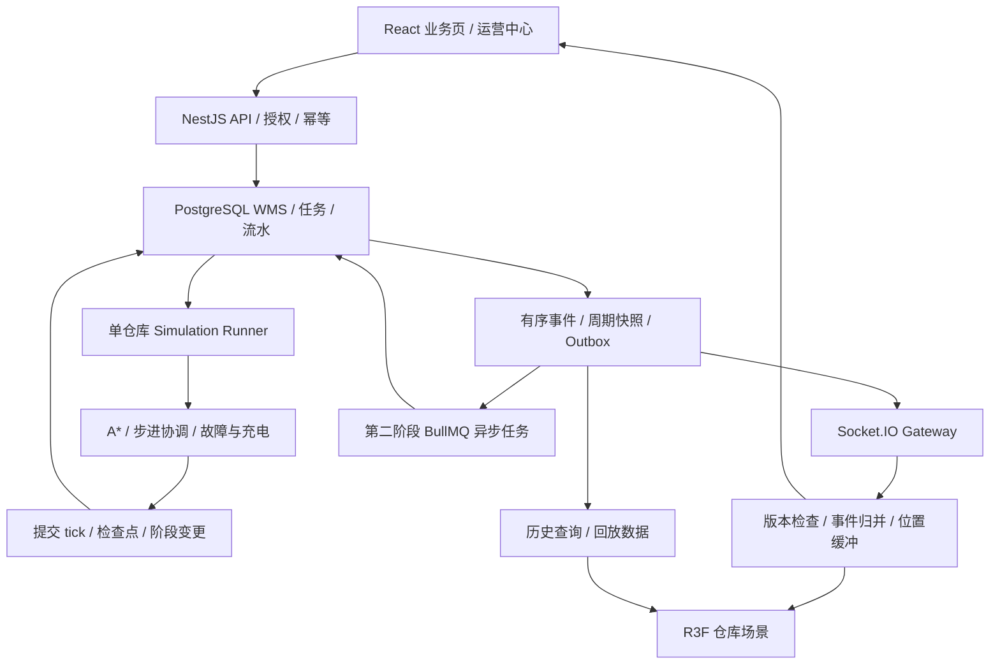

# WarehouseTwin：WMS 业务驱动的智能仓库数字孪生演示系统

制定日期：2026-10-23。周期：8 周 / 56 天。配套：[每日执行清单](./WarehouseTwin-56天每日计划.md) · [面试与 AI 协作手册](./WarehouseTwin-面试与AI协作手册.md)。

## 1. 项目定位与适用岗位

**用真实后端业务数据驱动 3D 仓库，让运营人员管理出入库、查看批次库存、调度模拟机器人、处理故障，并回放任务过程。**

建议仓库名 `warehouse-twin`，独立目录 `H:\codex\项目\warehouse-twin`。本次交付是待执行计划，尚未创建应用、远程仓库或部署。

面向：React/TypeScript 前端、Three.js/Web3D 可视化、数字孪生应用开发、偏可视化的 Node.js 全栈。目标是覆盖这些方向常见的主要能力，并形成可运行、可解释、可复验的作品；不能用一个项目承诺覆盖所有就业要求。

明确称为“模拟驱动的数字孪生演示系统”：业务与库存由后端真实持久化，设备由软件模拟，无真实 AGV/AMR、PLC、传感器或生产仓库。A* 不等于机器人自主导航，多机器人冲突协调不等于工业车队控制系统。本项目不覆盖 SLAM、ROS2 控制栈、机械运动学、安全认证、工业设备接入或高级渲染引擎研发。

### 招聘依据

查阅日期内，[Gatik 的 Simulation Platform 全栈岗位](https://job-boards.greenhouse.io/gatikaiinc/jobs/4656688006)明确涉及 React/TypeScript、Three.js/WebGL、REST/WebSocket、PostgreSQL、模拟数据、渲染性能、观测与容器。这是资深岗位，用于提取能力方向，不能把个人项目等同于其经验要求。

[华讯 3D 前端岗位](https://careers.eccom.com.cn/CN/IS/Careers/about/job.asp?JobPositionID=159)的搜索索引列出 3D 场景交互、动画联动、WebGL 和 CPU/GPU 资源优化；直接页面读取超时，作为辅助依据。这是少量定性样本，不代表市场覆盖百分比。最终以与你城市、年限、学历匹配的 10–15 条 JD 校准。

## 2. 两个月的范围与时间预算

你已有后端基础。按每周 6 个开发日、每天约 4 小时，外加第 7 天约 1 小时复盘，约 200 小时；预留 10–20 小时机动。React/Three.js 都陌生时，建议先做 5–7 天基础练习或将总周期延长至 10–12 周。

工时建议：WMS 与数据一致性 25%，3D/React 25%，模拟与路径规划 25%，实时/回放 15%，部署与展示 10%。验证贯穿开发，不能最后才补。

| 范围 | 必做 | 两个月内的限制 |
|---|---|---|
| 场景 | 货架/货位、入库、质检、拣货、出库区、充电位 | 参数化几何；一个固定版本布局，无可视化地图编辑器 |
| 交互 | 点选库存、状态颜色、搜索飞行、俯视/自由视角、区域筛选 | 颜色配图例与文本；提供 2D 列表替代入口 |
| WMS | SKU、货位、批次、入库、质检、出库、流水、盘点、预警、审计 | 一仓运行；单次搬运为一个 SKU/批次/数量，不做自动跨批拆单 |
| 机器人 | 1 台起步，5 台作为验收规模，10 台为扩展实验 | 网格、四方向、统一一格占地；不模拟连续物理与真实避障传感器 |
| 调度 | A*、任务分配、同格/对向冲突防止、通道互斥、等待与重规划 | 不承诺任意地图无死锁、全局最优或百台车性能 |
| 故障 | 暂停、维修后恢复、通道封锁、低电量回充、无人可接单 | 故障在网格步边界生效；载货中取消进入恢复流程 |
| 实时 | Socket.IO 仓库订阅、任务/库存/告警、重连与快照补齐 | 不依赖断线自动补发；一个 API/Gateway 实例起步 |
| 运营 | 任务统计、设备状态、库存热力、通道等待热力、历史 | 明确统计分母、时间窗与热力含义 |
| 回放 | 单任务时间轴、全仓状态上下文、暂停/倍速/拖动 | 保存的事件与快照回放；不重新运行当前 A* 冒充历史 |
| 后台任务 | 第二阶段接 Redis + BullMQ | 报表/回放索引/告警去重；不将每一帧运动塞进队列 |
| 权限 | admin、operator、viewer，HTTP/Socket/回放同样授权 | 演示空间隔离；不复制上个项目的完整 SaaS 管理平台 |

可砍项目顺序：精细 GLB 资产、Bloom/后处理、任意编辑地图、10 台车、自动跨批分配、复杂图表、独立监控大平台。不能砍后端库存来源、在途货物、重复完成防重、断线恢复和可解释的碰撞边界。

## 3. 完整演示故事

1. 运营人员创建 SKU-A、批次 B01 的入库单，收货到质检区，库存为待检。
2. 质检通过后，创建上架搬运任务，后端选择合法货位并预留容量。
3. 机器人从停靠位走到取货点，取货后货物进入该机器人的虚拟在途货位。
4. 机器人沿通道送货到货架对应的服务点；卸货完成后库存进入目标货位，3D 颜色和详情刷新。
5. 创建出库单，预占指定批次；机器人从货位取货，经拣货工作站处理，送到出库区。
6. 机器人搬运完成表示货已到出库区，运营人员确认发运才扣减仓库总库存。
7. 途中封锁一个空闲通道或注入设备故障，观察等待、告警、重规划或暂停恢复。
8. 回放该任务，查看历史轨迹、故障发生点、批次位置与库存变更，最后运行对账。

演示必须区分：货架内部的货位坐标与机器人在地面通道上的服务点。机器人不能穿过货架去到格子中心，也不宣称能真实举升到二层货架；加载/卸载是固定时间的模拟操作。

## 4. 技术栈与状态归属

| 层 | 技术 | 职责 |
|---|---|---|
| 前端 | React + TypeScript + Vite + React Router | 业务界面、路由、表单；组件库选一套即可 |
| 3D | Three.js + React Three Fiber + Drei | 场景、实例化、拾取、相机、动画与资源管理 |
| 场景状态 | Zustand | 选中对象、视角、图层、回放控制；高频位置用非 React 渲染订阅/ref 缓冲 |
| API 缓存 | TanStack Query | SKU、库存、单据、历史等服务端查询；keys 带演示空间/仓库/条件 |
| 后端 | Node.js + NestJS | 认证授权、WMS 事务、任务接口、Socket Gateway |
| 存储 | PostgreSQL + Prisma | 单据、批次余额、流水、任务、版本化布局、事件、快照 |
| 模拟器 | TypeScript 独立包 + 一个服务端 runner | A*、离散时钟、机器人状态、冲突检查、可复现 seed |
| 通信 | Socket.IO | 已提交状态的实时投递；HTTP 提交有副作用命令 |
| 后台任务 | Redis + BullMQ，第 6 周接入 | 有限重试的异步报表/索引任务，不决定库存真相 |
| 测试 | Vitest、Jest/Supertest、Playwright | 纯函数/前端、API/数据库、浏览器端到端 |
| 部署 | Docker Compose + Nginx + CI | 运行与验证环境；本地与在线演示 |

开发起点锁定相互兼容的 React、R3F、Three.js、Drei、Node、Prisma 版本，不直接套用不兼容教程。前端与后端共用契约类型，不把 ORM 模型原样暴露给页面；TypeScript 类型不能替代外部输入验证。

状态的唯一权威：WMS 库存和任务在 PostgreSQL；机器人运动由后端 runner 提交；前端只是显示。不能因为浏览器动画播放完，就直接宣布任务或出库完成。



## 5. WMS 数据与库存不变量

建议实体分期实现：users、spaces、warehouse_access、warehouses、layout_versions、zones、racks、locations、skus、batches、inventory_balances、inventory_movements、inbound_orders、outbound_orders、allocations、count_orders、transport_tasks、robots、runtime_checkpoints、warehouse_events、replay_snapshots、audit_logs、idempotency_records、job_outbox。

每个库位余额按 `(space, warehouse, location, sku, batch, quality)` 标识。quality 先支持 HOLD / RELEASED；只有已放行且未过期批次可分配。数量用整数件。货位可用容量使用简化“件数容量”而不是体积优化，MVP 储存货位同时只放一个 SKU/批次；增加容量预留防止多个上架任务争抢。

### 基本约束

- 每余额 `on_hand >= 0`、`0 <= reserved <= on_hand`；可分配还要满足质量、批次、盘点锁定和区域规则。
- 现存库存包括质检、库位、机器人在途、拣货/出库暂存，不能只汇总货架。
- 库内搬运不改变总数量；收货、最终发运、盘点审批调整才改变总量。
- 每次转移以 source/destination 两条关联流水或等价完整转移记录，同事务更新两端余额。
- 每任务阶段拥有业务唯一键，重复取货、卸货、发运和 BullMQ 重试不会二次改库存。
- 一台机器人最多承接一个有效运输任务；每任务分配不得被两台机器人同时认领。
- 货位容量满足 `已占数量 + 在途目标容量预留 <= 容量`；上架确认才把预留转为实占。
- 全部操作记录 actor、服务/模拟器身份、原因、关联单据、任务和事件 ID。

### 搬运阶段与库存变化

| 阶段 | 库存动作 | 关键说明 |
|---|---|---|
| 入库收货 | 外部 → 质检区 HOLD | 收货幂等，真实增加仓内总库存 |
| 质检通过 | HOLD → RELEASED | 质量状态变更记录来源；失败保持隔离 |
| 创建运输任务 | 预占来源 + 预留目标容量 | 此时物理库存位置不变 |
| 取货确认 | 来源 → 机器人在途货位 | 来源余额/预占减少，在途余额/任务预占增加，总量不变 |
| 上架卸货 | 在途 → 目标货位 | 释放任务占用与目标容量预留，货位库存可用 |
| 出库搬运 | 库位 → 在途 → 出库暂存 | 中间可在拣货工作站停留处理；未卸货前仍在途 |
| 到达出库暂存 | 运输完成、库存保持订单预占 | 不能在“任务完成”时提前减总库存 |
| 确认发运 | 出库暂存 → 外部 | 幂等扣减现存与预占，出库单完成 |

出库单首版指定一个 SKU/批次/数量，记录分配建议，可用 FEFO 排序推荐最早到期批次；不足则拒绝并提示拆单，不伪称完整自动跨批分配。多行、拆批、波次、补货优化为后续扩展。

任务状态建议 QUEUED / RUNNING / PAUSED / NEEDS_RECOVERY / COMPLETED / CANCELLED；phase 单独表示 TO_PICKUP / LOADING / TO_DROPOFF / UNLOADING。机器人状态为 IDLE / RUNNING / CHARGING / FAULT / PAUSED。

取货前取消可释放来源预占和目标容量；取货后不直接取消或释放货物，进入 NEEDS_RECOVERY，保留在途货位及货物，维修后完成原运输或执行明确恢复任务。MVP 不做自动跨机器人接驳。

盘点首版按单货位冻结：开始盘点时检查无预占、无在途指向、无活动运输；冻结后禁止新分配。盘点提交不直接改余额，审批确认差异后写调整流水；发生版本变化则拒绝并重新盘点。拒绝或结束后解除冻结。

## 6. 地图、A* 与机器人模拟的精确范围

### 地图与坐标

业务货位使用稳定 ID，地图使用 `(gridX, gridZ)`，渲染使用右手世界坐标，Y 向上；统一 cellSize 与原点。货架体积投影为不可通行网格；货位关联合法地面 serviceCell。不能从 3D mesh 名称猜测业务 ID。

起步地图约 30×20 格，50–150 个业务货位；验收扩展至 300–500 货位、5 台机器人；单独渲染压力样本可到 2,000 个重复货位实例和 10 台机器人。测试规模是目标，不是现有效果。

静态 layoutVersion 包含通道、货架、工作站、容量和服务点。运行中仅允许受控封锁通道，整张布局更新需停止相关运行并创建新版本。回放必须使用历史布局。

### A* 基线

四邻接、不走对角、基础边权为 1；使用 Manhattan 启发函数和优先队列。单机器人静态等权地图的最短路用 BFS 作为测试对照。后续拥堵代价只能为非负额外成本；明确质量/性能取舍。

结果包含 path、layoutVersion、cost、expandedNodes、duration 与失败原因。起终点非法、无路、地图变化都应有明确状态，不允许返回直线穿墙。时间上限或扩展节点预算超出后暂停等待/报告，而不是无限占用 Node 事件循环。

### 时间与运动

默认固定逻辑步长 250ms，即 4Hz 的权威网格步进；每步最多一格。速度只是演示参数，不是实际机器人速度模型。前端以显示帧率在已确认轨迹段间插值，不通过帧数计算业务进度。

模拟时间、服务器墙上时间、浏览器渲染时间分开。服务器暂停或处理过慢时，逻辑时间暂停/变慢并显示 lag，不无限追赶历史 tick；重启从最后已提交 tick 继续，不凭现实时间跳到任务结束。

每个仓库只有一个合法 runner owner。通过数据库 lease + 递增 epoch 认领；每次提交校验 owner/epoch/lease 与 expectedTick，旧进程即使恢复也不能再提交。数据库不可用时停止权威推进。

为了两个月内可靠实现，MVP 使用单仓库串行提交：相关事务先锁 warehouse runtime 行，再以固定顺序锁库存/任务记录；写入状态、tick checkpoint、业务流水与事件后提交。路径计算在事务外完成，提交时校验地图与状态版本，过期结果丢弃重算。这个粗粒度方案限制吞吐，但便于证明小规模演示的一致性，应在报告中公开。

### 多机器人冲突协调

第一阶段仅一台机器人；第二阶段增加集中式逐步协调：

- 单台 A* 规划几何路线，调度器对下一步统一检查。
- 禁止两个机器人同一步占同一格，禁止同一条边对向交换。
- 采用保守规则：下一步不得进入其他机器人当前占用格，即使对方本步打算离开；这样降低跟车冲突复杂度，代价是吞吐下降。
- 狭窄通道作为单容量资源；取得通道许可前不能进入，确认离开后释放。故障机器人还在通道内时不能因超时直接释放物理占用。
- 稳定优先级 + 等待时长 aging 缓解饥饿；无进展达到阈值后暂停、重规划或请求人工解除堵塞。
- 停车位、充电位与工作站也检查容量；空闲/故障车辆持续占用位置。
- 封锁命令只在步边界生效，不能封锁当前占用格或已批准的运动段；冲突时拒绝或等待安全边界。

此策略在定义的离散地图/占地/速度假设下验证不重叠，不保证任意地图都能完成全部任务，也不是最优 MAPF。闭环等待可能只能安全停住并告警。空间-时间 A* / CBS 是选修对照，不要求两个月内实现。相关问题与单机器人寻路的区别可参考 [MAPF 研究论文](https://www2.cs.sfu.ca/~hangma/pub/aij21.pdf)。

电量按步与载货耗费模拟，接单前估算完成任务及到充电位所需电量并加余量；不足时先充电。通路突然中断或电量不足时安全暂停/恢复，不能把故障车辆瞬移到充电点。MVP 故障在步边界生效，不声称覆盖边中停车的连续物理碰撞。

## 7. 实时同步与可复现回放

### 两种数据不同处理

- **业务事件**：库存、任务阶段、告警、地图封锁等，先持久化后推送，带 eventId、warehouseId、seq、schemaVersion、layoutVersion、simEpoch、tick、serverTime。
- **运动数据**：每个已提交 tick 的紧凑位置/方向批次，作为轨迹记录持久化；实时传输可丢弃过期包、保留最新状态。渲染插值不是新业务事件。

MVP 的 warehouse seq 在同一 runtime 行锁下分配并随事务提交；不要直接把 PostgreSQL 自增 ID 当成提交顺序水位，避免较小 ID 晚提交造成补拉漏数据。持久化状态与事件同事务提交；广播失败仍能从事件表补拉。

### 首次连接与重连

先验证用户和仓库访问权，再订阅；从一致快照获得状态与 seq 水位，并缓冲同一订阅期间的新事件，应用大于水位的数据。按 seq 去重/发现缺口，超出保留期或无法补齐时重新获取快照。实现时测试“快照读取期间恰好有库存变化”的窗口。

Socket.IO 保证已送达事件的顺序，但默认不是可靠离线事件日志；额外投递保证需要应用实现。[官方投递说明](https://socket.io/docs/v4/delivery-guarantees/)。连接恢复可能失败，仍要有全量同步路径；授权也要重新检查。[连接恢复说明](https://socket.io/docs/v4/connection-state-recovery/)。

Zustand 管 UI、选中项、图层和回放控制；TanStack Query 管业务查询缓存，其 key 包含空间/仓库/过滤条件。收到事件可以按版本更新缓存或使其失效；避免把两份库存分别写进 Query 和 Zustand 后各自修改。切仓、退出、进入回放时要清理旧订阅与请求。

### 历史回放

记录完整 task events、每 tick 轨迹批次和周期性全仓快照，起步每 20 tick/5 秒一份快照。快照包含库存摘要、机器人、任务、布局版本和事件水位；单任务回放可筛选高亮该任务，但仍读取同时间的全仓上下文。

回放通过最近快照 + 后续事件恢复选定时刻，可暂停、0.5/1/2 倍速、拖动；不调用现在的调度器重新“猜”过去路线。live 与 replay 使用独立 store/订阅，回放模式显著标识并禁用写操作。返回 live 必须重新同步。

保留策略：演示保留最近 24 小时或固定场景；归档时事件与其所需基线快照成组保留/删除，不能删掉重建起点。记录缺口应显示“不完整”，不能用插值伪造未记录的库存或任务事实。

## 8. 3D 实现与性能路线

用参数化 Box/Plane 构建可读、风格统一的仓库，先避免外部大模型资产依赖。小车用简单几何体；GLB 模型替换和压缩作为选修。场景细节不能淹没货位和运行状态。

必要能力：Scene/Camera/Mesh/Geometry/Material、坐标变换、透视与正交相机、raycasting、instanceId 到 locationId 映射、相机 fly-to、图层过滤、灯光阴影、资源生命周期。

重复货架/箱体使用共享几何材质与 InstancedMesh，降低 draw calls；更新实例颜色/矩阵需维护映射与更新标记。[Three.js InstancedMesh 文档](https://threejs.org/docs/pages/InstancedMesh.html)。

高频动画放在 `useFrame` 与 ref/位置缓冲中，不逐帧 setState 导致整页 React 重渲染；性能模式明确 DPR、阴影和标签数量。[R3F 性能陷阱](https://r3f.docs.pmnd.rs/advanced/pitfalls)。

区分 React/R3F 管理的资源与手动创建、缓存或共享资源的所有权；不再使用的 geometry/material/texture 要正确释放，共享资源不能被一个组件提前销毁。[Three.js 资源清理](https://threejs.org/manual/pages/how-to-dispose-of-objects.html)。

颜色语义分层：库存层显示空/可用/预占/待检；设备层显示运行/空闲/充电/故障；拥堵层显示时间窗内等待 tick 比例。一次只激活一个主热力层，避免同一红色代表三个含义。提供 legend、数值和选中详情。

### 性能目标与测量

声明测试机器/GPU、浏览器、窗口尺寸、DPR、货位数和机器人数量后测量：frame time p50/p95、FPS、draw calls、triangles、geometry/texture 计数、JS heap（能测时）、Socket 消息量/字节、端到端状态延迟、tick 处理耗时。

目标是在声明环境下 300–500 货位 + 5 台车操作流畅，争取 60fps，低配模式争取稳定 30fps；不是未测试就保证的数字。移动和静止分开测试，固定相机轨迹、预热后至少记录 60 秒。自动化浏览器/软件渲染结果不能冒充真实 GPU 性能。

每步处理耗时应显著小于 250ms 预算；超预算显示 lag 并限制新任务。渲染压力测试与完整后端仿真压力测试分开，不能用前端假机器人数量宣称调度能力。

## 9. 第二阶段 Redis / BullMQ

第 1–5 周先跑通单进程 runner、数据库事件与任务状态。第 6 周再加入 BullMQ，承载回放索引、报表导出或告警聚合中的一到两个真实任务。

数据库中创建 job intent/outbox，与源业务同事务提交；后台发布到 BullMQ，保存业务 key。jobId 去重不能替代永久业务幂等：任务清理后仍可能重新入队，worker 必须用数据库唯一键/状态判断防重复结果。[BullMQ 幂等任务](https://docs.bullmq.io/patterns/idempotent-jobs)。

处理有限重试、退避、失败记录、worker 重启、Redis 不可用和恢复。核心库存事务、模拟时钟与逐步运动不依赖队列恰好执行一次。Redis 故障可让异步报告延迟，不应让已提交库存消失。

MVP 不把 Socket.IO Redis adapter 当作持久事件存储，不以添加 Redis 就宣称支持多实例有序同步。Gateway 水平扩展作为架构讨论，实际演示先单 Gateway。

## 10. 核心验证清单

| ID | 场景 | 验收证据 |
|---|---|---|
| T01 | 刷新/重启后查看货位 | 3D 与 API/DB 同一版本数据，无前端写死库存 |
| T02 | 重复收货、取货、卸货、发运 | 每个逻辑动作仅一组流水；库存不重复增加/减少 |
| T03 | 多任务争抢同一批次/目标容量 | 不超分配、不超容量，失败无半成品任务 |
| T04 | 拾货后机器人故障 | 货保留在在途库位，总量守恒，恢复不重复搬运 |
| T05 | 出库搬运完成但未发运 | 总库存未减少；确认发运后才减且只减一次 |
| T06 | 盘点与新分配并发 | 冻结/版本规则生效，盘点不能覆盖在途或新变更 |
| T07 | A* 正常/无路/非法点 | 正常路径合法；静态等权下与 BFS 长度一致 |
| T08 | 同格争抢、对向交换、单通道 | 无非法重叠；等待与资源归属可解释 |
| T09 | 封路、故障、闭环等待 | 不穿墙，不释放仍被占用通道；无法推进时告警停住 |
| T10 | 低电量与充电位争抢 | 不分配明显无法完成的任务，充电位不超占 |
| T11 | 两个 runner / 重启旧进程 | epoch/lease 阻止双写；从已提交 tick 恢复 |
| T12 | 重复/缺失事件、断网、快照竞态 | 去重补齐或全量重同步，UI 不静默保持旧库存 |
| T13 | 回放拖动与实时隔离 | 相同时刻的状态摘要一致，回放不触发业务写操作 |
| T14 | 切仓、订阅、历史/导出权限 | 无跨空间泄漏，旧请求不会覆盖新仓状态 |
| T15 | BullMQ 重试、Redis 中断 | 不重复生成逻辑结果，源数据完整，恢复后补处理 |
| T16 | 连续运行与场景进出 | 指标记录完整；资源计数不持续单向增长，任务/库存账平 |

并发业务测试必须使用真实 PostgreSQL 多连接。仿真测试使用固定地图、seed、命令顺序和 tick；记录哪些故障场景实际跑过。碰撞检查至少覆盖 cell 占用、edge swap、单容量通道，不以“看起来没撞”代替断言。

对账：按 SKU/批次汇总所有实物/虚拟库位 = 期初 + 收货 + 盘点净调整 − 发运；每个有效 allocation 与库存 reserved、任务阶段相符；未完成载货任务必须能找到对应 transit 库存。多表比较使用同一快照，避免时间差误报。

## 11. 每周交付与目录

| 周 | 主线 | 周末成果 |
|---|---|---|
| 1 | 工程/契约、基础 WMS 与后端布局、React/R3F 场景 | 货位可点选、库存来自 API |
| 2 | 入库质检、出库预占、盘点、流水、场景交互 | 真实业务数据驱动颜色与详情 |
| 3 | 网格 A*、单机器人、时钟、取放货事务 | 一台车完成上架/出库搬运 |
| 4 | 多机器人冲突、封路、故障、充电、恢复 | 5 台车与可解释等待/重规划 |
| 5 | Socket.IO、运营中心、热力图、快照回放 | 实时 + 断线恢复 + 时间轴 |
| 6 | Redis/BullMQ、重复/并发/故障、观测 | 正确性与恢复报告 |
| 7 | 3D/React/SQL 性能、内存、部署 | 实测优化、在线候选版 |
| 8 | 复验、README、录屏、简历与面试 | v1.0.0 和可复现实验 |

```text
warehouse-twin/
  apps/web/                  # React 管理页与 3D / 回放
  apps/api/                  # NestJS WMS / Socket Gateway
  apps/simulator/            # 服务端 runner
  apps/worker/               # 第二阶段异步任务
  packages/contracts/        # DTO / 事件 / 版本协议
  packages/simulation/       # 纯 TS 时钟、A*、协调与规则
  packages/database/         # Prisma、迁移、seed
  packages/scene/            # 坐标转换、实例映射等按需共享
  tests/integration/         # 真实数据库与权限
  tests/scenarios/           # 固定 seed / 故障 / 并发
  tests/e2e/                 # Playwright
  data/layouts/              # 合成布局及来源说明
  scripts/                   # seed / demo / reconcile / benchmark
  docs/planning/
  docs/adr/
  docs/devlog/
  reports/
  infra/
  .github/workflows/
  README.md
```

## 12. GitHub 与演示交付

README 首屏放业务一句话、在线 Demo、短视频、场景截图、数据一致性与性能报告。后面是安装、数据库迁移、seed、角色、地图坐标、库存规则、事件协议、测试与限制。

计划中的脚本入口：`pnpm dev`、`pnpm seed`、`pnpm test:unit`、`pnpm test:integration`、`pnpm test:scenarios`、`pnpm demo:warehouse`、`pnpm reconcile`、`pnpm bench:scene`。开工后实现并验证，不能现在声称这些命令可执行。

Docker Compose 包含 Nginx、web、api、simulator、PostgreSQL，第二阶段增加 Redis/worker。公开 Demo 每个访客隔离空间、限任务/机器人/运行时长；故障演示只允许固定可恢复场景，不能开放任意资源压测和数据库重置。单机部署限制要公开。

不需要真实机器人或 GPU 云服务器；浏览器 3D 由访客设备渲染，服务端负责业务与模拟。主机配置和费用按实测与当时报价决定。模型/贴图优先自制几何或明确授权资产，记录 License；没有图形支持时提供 2D 面板和明确标注的录像。

每开发日 2–4 个有价值提交，每周 1 次复盘/版本发布；参考总量约 90–150 个，不是考核配额。提交应体现真实功能、风险验证或实验，不能补造时间或空提交。AI 辅助不等于应用要接 LLM，本项目无须模型 API。

最终条件：能独立演示入库→质检→上架→出库搬运→发运；故障时在途库存不丢；重复动作不重复过账；断线后恢复；历史可回放；场景性能有声明环境下的实测；GitHub、视频、部署/本地替代方式齐全。

与前两个项目的差异：SupportOps 强调 Agent；TradeFlow 强调 SaaS 交易；WarehouseTwin 强调空间可视化、仿真与实时数据一致性。它们各自约两个月，不建议在同一个每天 4 小时的周期内并行完成三套。
