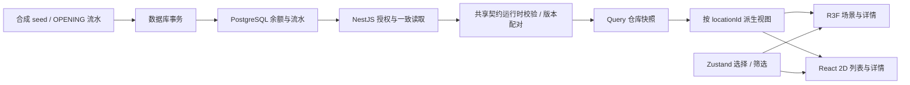

# ADR 0004：场景数据、交互与相机边界（Day 4–6）

实际日期：2026-11-02。状态：采用。接续基线 `f246d5c`，没有新增数据库表或业务写命令。

## 状态归属

| 状态 | 所属 | 约束 |
| --- | --- | --- |
| 布局、库存、余额、角色 | PostgreSQL / API | 浏览器只读业务数据，不用动画或颜色决定库存 |
| 布局+库存读取快照 | TanStack Query | key 含 userId、spaceId、warehouseId；不使用上一仓 placeholder |
| 选择、图层、筛选、视图模式、相机请求 | 每个仓库页面独立的 Zustand store | 只存 ID 和 UI 参数，不存另一份库存；切仓卸载时丢弃 |
| 相机插值和 controls | R3F useFrame / ref | 一次只保留最新移动；不逐帧 React setState，不是模拟器 tick |
| 表单输入、登录提示 | React local state | 请求代次和 AbortSignal 防止旧响应覆盖后续身份 |

`packages/contracts` 是实际被 API 和前端共享的响应类型及 Zod schema。API 映射结果用 satisfies 约束，前端先把网络结果视为 unknown 并运行时校验。包输出 ESM；API 当前只导入其类型，不把 ORM 模型直接暴露到页面。

## 一致读取与错误

Query 同时请求 layout/inventory，核对 scope、layoutId/version、货位全集、容量和数量合计。仅布局版本不一致时重取两个接口一次；仍不一致就报错。HTTP 401/403/404、网络失败、格式错误不做隐式重试，不回填默认库存。

每个响应内部是 DB 一致快照，组合读取仍是应用层按版本校验，并非两个请求共用数据库事务。重取期间可标明显示上次成功快照；确定失败后隐藏旧场景及汇总。真实空仓可显示 0，但缺少 inventory 响应不等于空仓。退出/401/到期时取消查询并清除缓存。

前端按计划接入 React Router、Query、Zustand、Vitest，并新增实际使用的 Zod。沿用原 React/R3F/Three 版本。包管理器 24 小时成熟期规则保持，Query 采用已过等待期的 5.104.5，没有为安装最新版本关闭规则。

## 坐标、几何和资源

格心转换沿用 ADR 0001：原点为网格外缘，Y 向上，cellSize 为米；矩形中心按边缘计算，不能多加半格。位置与容量来自 API 的当前发布版本，货架投影和 serviceCell 分开。

场景包括地面、6 类区域、参数化货架、空/有货标记、灯光和阴影。没有外部 GLB、纹理或网络字体。重复项目前为独立 mesh，以 locationId 作为 React key 和 userData，尚未做 InstancedMesh 优化。

3D 模块按需加载，失败由边界提示，API 汇总和 2D 入口仍在。geometry/material 由 R3F 声明式树持有并随卸载清理；OrbitControls 的订阅由 Drei 管理；上下文丢失监听有显式清理。没有据此宣称长时间资源计数已稳定。

## 拾取与颜色

货位 group 的 click 使用闭包中的稳定业务 ID，并 stopPropagation；货架也 stopPropagation，防止点中货架却选后方货位。拖动超过阈值不算点选。空位仍有可拾取几何，列表/下拉同样可选。

颜色同时有文字图例、数量和批次详情。聚合优先级为空位 → 待检 → 预占 → 可用 → 不可分配；后者包含过期等有现存但无可用量情况。多质量行的合计不抹掉各行 SKU/批次/质量；状态颜色只提供展示语义。

货架实体遮挡时不穿透选择；可以转动相机、使用列表或搜索。俯视情况下货架顶板可能遮住其下货位，这不是让 raycast 忽略实体的理由。

## 相机、筛选与 2D

搜索按货位 code/ID 精确优先，模糊多结果须选择；无匹配不生成位置。定位解除展示筛选，使目标可见。相机支持自由透视、俯视正交、重置；正交 frustum 随画布长宽比更新，透视更新 aspect。

移动用 .65 秒 smoothstep 插值，每帧通过 ref 更新位置、target、zoom；新的请求替换旧请求，用户拖动或卸载会取消。OrbitControls 关闭惯性，以免程序移动后仍有尾随。canvas 的 transition/target data 属性仅供验收完成状态使用，不改变业务状态。

区域筛选只生成展示视图，不改 Query 对象、布局 blockedCells 或库存。货架障碍仍显示，顶部明确为全仓汇总。2D 列表与详情从同一 Query 快照生成，列表模式不挂载 Canvas；冷启动禁用 WebGL 和真实上下文丢失均有浏览器验证。

## 验证与交付边界

Vitest 验证坐标、契约、取消、cache scope、状态/详情、搜索/筛选和相机计算；Jest/Supertest 继续跑真实 PostgreSQL。浏览器采用 [Playwright 技能](C:/Users/27019/.codex/skills/playwright/SKILL.md) 的 CLI 会话，使用独立 QA DB 和公开测试夹具账户，不使用开发密码或个人浏览器。

CI 定义于 `.github/workflows/ci.yml`，Windows runner、固定 Node/pnpm、冻结安装、Prisma 生成、check、Vitest、真实 DB 集成及结果上传。对应命令本地通过，远程运行需推送后确认，不能把配置文件当成 CI 成绩。

当前不实现业务分配、机器人运动、Socket、回放、实时库存更新、复杂性能档位、搜索路径算法或工业设备接入。没有测量 FPS、吞吐或长期资源曲线。

## Day 7 复盘：一条库存从数据库到屏幕（2026-11-04）

沿用 [ADR 0001 的坐标与单位](0001-scope-and-coordinates.md)，不新增第二套转换或状态容器。

以 R01-1-L1 为例：`seed-inventory.cjs` 在持有仓库行锁的 seed 事务中写入余额与 OPENING 流水，记录 `actorType=SEED`、来源布局及业务唯一键。前端启动和刷新都不会执行 seed。API 从 DB 读取当前已发布布局和余额，按读取时刻排除 HOLD/过期库存的可用量；网络数据经共享 schema、归属和版本校验后进入 Query。`locationViews` 用稳定 locationId 关联总量与批次；3D 点击和 2D 按钮只改变选择 ID，复用同一个详情组件。

格心 X/Z 为 `origin + (grid + 0.5) * cellSize`；货架矩形中心按矩形边缘计算，不能再多加半格。层高决定显示 Y；serviceCell 表示地面接近点，不是架内货位。筛选隐藏显示对象不会改变 blockedCells。

**事务边界**：seed 的余额、期初流水和初始布局同事务；每个只读 API 的权限/布局/库存读取使用 RepeatableRead。layout 与 inventory 两个请求分别提交，前端按布局版本配对，不能声称是跨请求原子快照。当前没有库存写接口，不能将 QA 的 `reserve` 夹具维护等同业务预占；未来业务写入必须另行设计。

**同步边界**：只有首次读取与手动刷新，没有 Socket 或事件水位；整页重载清掉内存 UI 状态，从服务端恢复业务数据。相机完成只代表画面就位。所有异步读取沿用 AbortSignal，切仓/身份变化防旧响应覆盖。不要用动画完成修改余额。

**React 与清理**：React 渲染声明 UI，不应执行数据库写入；useEffect 负责订阅与同步并返回清理。当前 StrictMode 下 effects 可能经历额外 setup/cleanup，故取消请求、解绑 context-loss listener 和丢弃相机 motion 都必须可重复执行。Drei 管理 controls 订阅，声明式 mesh 资源由 R3F 管理；这不构成长时间资源稳定性的实测结论。

**验收与理解分开**：2026-11-04 已实际验证两个 raycast 详情、17 行列表、整页刷新前后 API 和汇总一致。开发者独立口述仍待完成：①不用看代码画 DB→屏幕；②解释 Query/Zustand/ref；③说明 useEffect cleanup 与 StrictMode；④指出 seed 与运行时数据边界。AI 撰写这段说明不代表用户已经独立掌握。
