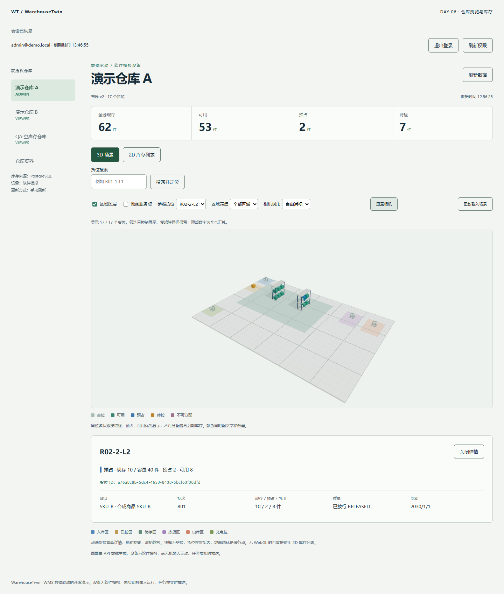

# Day 6 验收：相机、筛选、2D 与 CI

实际日期：2026-11-02。基线 `f246d5c`，包含接续的本地 Day 4/5。计划阶段编号不代表三次自然日或三个已提交版本。

## 5 项可观察验收

| 条件 | 实际验证 | 结果 |
| --- | --- | --- |
| 搜索正确定位 | code/ID 精确优先、多结果和未找到单测；浏览器依次搜索 R01-1-L1、R02-2-L2、CH-01 | 通过 |
| 快速操作无旧移动队列 | 最后请求完成时 transition=idle，目标为 CH-01 的 `[1.5,0.5,16.5]`；新请求替换旧 ref | 通过 |
| 相机与筛选有效 | 自由透视/俯视正交、重置、800×900 resize；QC 显示 1 位、STORAGE 12 位，隐藏选择清除 | 通过 |
| 无 WebGL 仍有业务入口 | 实际 context loss 后 2D 可用；另起 `--disable-webgl` 浏览器，WebGL2=null，17 行与 QC HOLD 详情正常 | 通过 |
| 验证链路可复现 | 冻结安装、check、Vitest、真实 PostgreSQL/Jest 本地通过；CI workflow 覆盖同一链路 | 本地通过，验收时远程未运行 |

## 实际检查结果

- `pnpm install --frozen-lockfile`：5 个 workspace，成功。
- `pnpm check`：lint、strict typecheck、API/契约/web build 成功。
- `pnpm test:unit`：5 文件、35 项通过（坐标 7，数据/取消/cache 12，错误态 1，库存视图 9，相机 6）。
- `pnpm test:integration`：2 suites、44 项通过；真实 PostgreSQL 重启后全量重算 0 差异。
- Playwright CLI：抽样详情、真实 raycast、7 个导航/降级检查、冷启动无 WebGL、v2 布局刷新、预占夹具详情及截图均实际通过。
- 浏览器 HTTP 503 故障注入后旧场景和汇总隐藏，解除后重试恢复；真实空仓四项汇总为 0；切仓清空旧选择。

Windows x64、Node 22.14.0、pnpm 11.25.0。正常图形会话为 Chrome / NVIDIA RTX 3060 Laptop GPU / ANGLE D3D11；截图 viewport 1440×1100，另测 800×900。未测 FPS、frame-time、吞吐或软件渲染性能。

## 失败修正与限制

最初以两个 PNG 字节完全相同作为稳定性条件失败；这不是可靠的 GPU 动画完成判据。改为明确结束状态与最终 camera target，关闭 OrbitControls 惯性并在末帧落到精确端点，实际验证通过。不宣称像素级确定性。

CI 文件 `.github/workflows/ci.yml` 使用 Windows runner 和精确工具链，执行安装、Prisma 生成、check、unit、integration，上传结果；官方 Action 标签已用 git ls-remote 核实。本地验收时尚未推送，故本报告没有远程 Actions run URL，也没有把本地通过写成 CI 已绿。提交后的状态以 GitHub Actions 为准。

仍有 3D chunk >500kB 警告和依赖 Three.Clock 弃用警告；已按需加载，但未夸大为性能优化成果。故障注入产生预期的 HTTP 503 / WebGL 控制台错误，不能据此声称正常路径有运行异常，也不能宣称整个会话零错误。

无真实机器人、业务预占/收发货、Socket、回放、实例化大规模渲染、完整地图编辑器、生产部署或跨浏览器矩阵。原始 seed 库存规则不变，QA 预占和额外空仓仅存在于临时测试 DB。

## 证据与复现

原始本地产物：`reports/unit.json`、`reports/integration-jest.json`、`reports/integration-environment.json`、`reports/integration-inventory.json`；这些 JSON 忽略入 Git。可执行 CLI 回调在 `scripts/browser-checks`；交互终端运行 `pnpm qa:browser` 后使用独立测试浏览器执行。详细命令见 [浏览器验收说明](../scripts/browser-checks/README.md)。

