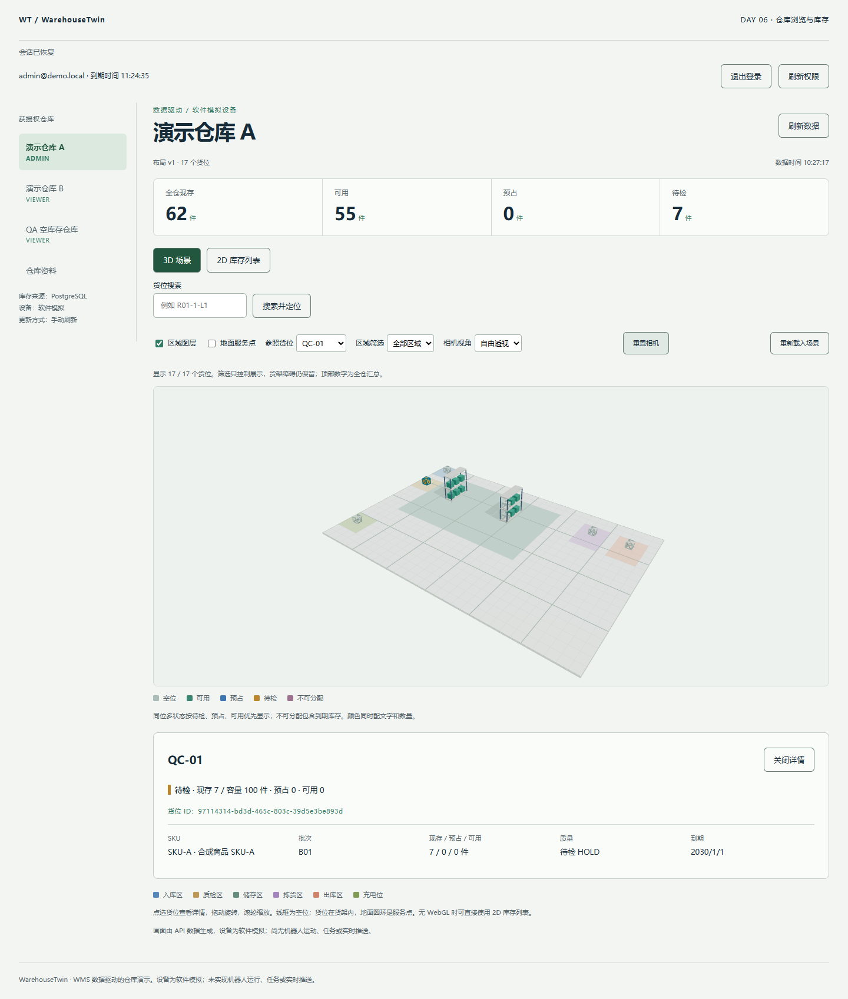

# Day 7 验收：轻量复盘与 v0.1-scene

实际日期：2026-11-04（Asia/Shanghai）。应用代码基线 `b993d9f9c305952065b87e611b06eeb4eb023dd1`。今天增加浏览器验收脚本、媒体和说明，没有更改应用/数据库实现或依赖。包含同日先完成的 Day 6 复核记录。

## 最小交付与状态边界

按三个可审查部分交付：①`day7-demo.js` 及演示媒体；②现有 ADR 的 DB→屏幕/坐标/清理复盘；③日报、README 和 `v0.1-scene` 发布说明。没有为复盘新增业务接口、服务、框架或 schema。

PostgreSQL 是布局、余额、流水与权限的权威；Query 缓存经校验的服务端快照，Zustand 只保存 UI，R3F/ref 处理显示。seed 的布局/余额/期初流水同事务；每个 API 读取是独立 RepeatableRead，两个 HTTP 响应只按布局版本配对。首次读取和手动刷新是当前同步方式，没有实时投递。

## 5 项可观察验收

| 条件 | 当日实际结果 |
| --- | --- |
| 搜索后真实点选，详情正确 | R01-1-L1、R02-3-L2 均先搜索定位、关闭详情，再在 Canvas 中心发出鼠标点击；正确 locationId 被选中 |
| 3D/2D/API 一致 | 两个射线选中货位的详情文字与 2D 详情完全一致，并核对 API 的 ID、容量、数量、SKU/批次/质量；R01-1-L1 为 1/0/1，R02-3-L2 为空位 0/0/0 |
| 列表覆盖完整且刷新持久 | 列表 17 个货位逐行现存/预占/可用与 API 一致；整页 `page.reload()` 后布局和库存响应（排除 asOf）不变，再次验证 17 行 |
| 恢复后汇总与 HOLD 正确 | 现存 62、可用 55、预占 0、HOLD 7；刷新后的 UI 与 API 一致，QC-01 的 HOLD 详情正确 |
| 演示与数据来源可追溯 | 录制并保存 VP9 WebM，抽帧查看；普通 seed v1，没有执行 QA reserve/layout-v2。ADR 已说明 SEED 期初流水与运行时读取边界 |

最后一项是可查的工程说明；用户独立画流程/口述尚未验收，未代写“已掌握”。也没有把 17 行列表核对说成 17 次射线点击。

## 验证记录与媒体

- 同日 Day 6 复核已实际执行 `pnpm check`、`pnpm test:unit`、`pnpm test:integration`：35 项前端、44 项 DB/API 通过，DB 重启后对账 0 差异。应用代码未变，不重复制造另一轮通过记录。
- 新增 Day 7 回调实际执行并返回 passed=true，含 fullDocumentReload、inventoryUnchangedExceptAsOf、layoutUnchanged 和两次 raycast/detailMatches2D。修改回调后再次运行并通过。
- 新回调使用 Playwright CLI，不增加 @playwright/test 或项目依赖；完成后 lint 与文件差异检查用于发布收尾。
- 基线远程 [warehouse-checks / run 41392140712](https://github.com/JoeyXXia/threejs/actions/runs/41392140712) 为 success，包含冻结安装、生成、check、unit、integration。新发布提交的 CI 结果应单独查看，不能沿用基线成功结论。

[演示录像](day-07-demo.webm)为原始 47.12 秒录屏中从第 15 秒开始连续截取的 15 秒，无动作重排、无语音；1440×1100，VP9，25 fps 为录制参数，不是应用帧率测量。已解码抽查拾取详情和列表画面；原录屏和抽帧保留于忽略的 `output/playwright/day-07`。

## 环境、失败与限制

Windows x64、Node 22.14.0、pnpm 11.25.0、Chrome。独立 QA PostgreSQL/API/Vite 使用 15434/13004/15174，公开测试夹具登录，不读取开发 .env。QA 环境有额外只读仓库与空仓，但本次演示只操作 A 仓普通 seed；不是生产收货、质检或预占流程。

首次 lint 发现回调中未使用变量，改为按键排除 asOf 后通过。首次 video-start 缺配套 ffmpeg，虽然浏览器断言通过，未据此声称录像成功；安装 CLI 工具配套二进制、结束异常录制状态后重新开始，最终文件存在并可解码。录制工具安装不改变 lockfile。

初始匿名 `/auth/me` 的 401 是会话探测；保留 Three.Clock 弃用警告及既有 3D chunk 警告。未测 FPS、长期资源、跨浏览器或生产部署。页面仍显示 Day 06 功能标识，Day 7 是该功能基线的复盘发布。

## 复现与版本

按[浏览器验收说明](../scripts/browser-checks/README.md)启动独立 QA、登录，执行 `day7-demo.js`，先 video-start，回调完成后再 video-stop。验收回调失败时不得发布。

阶段标签为 `v0.1-scene`，能力与复现见[发布说明](../docs/releases/v0.1-scene.md)。提交 SHA 由 `git rev-parse v0.1-scene^{commit}` 查询，避免把应用基线冒充发布提交。媒体与报告随发布提交保存。
