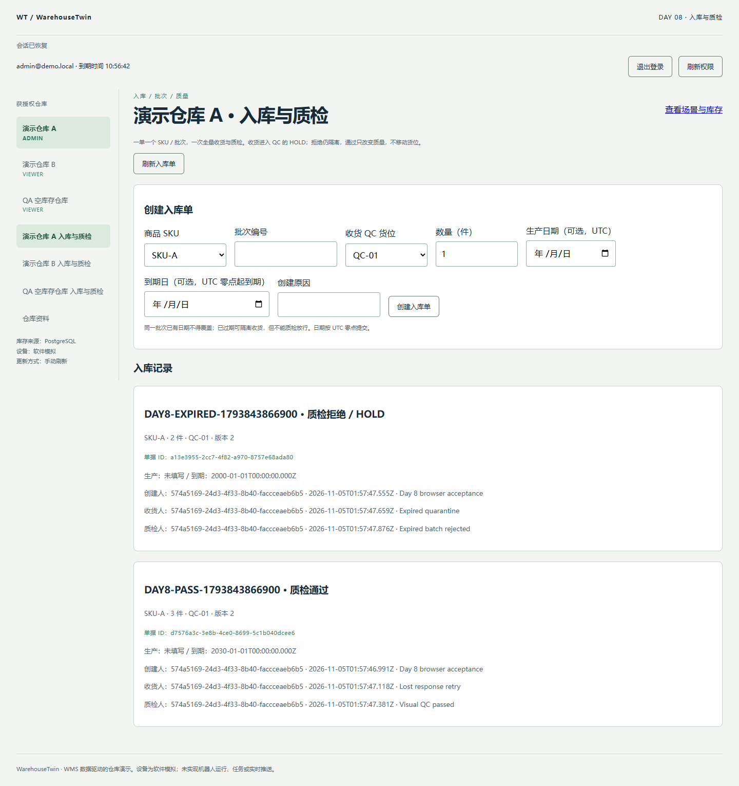
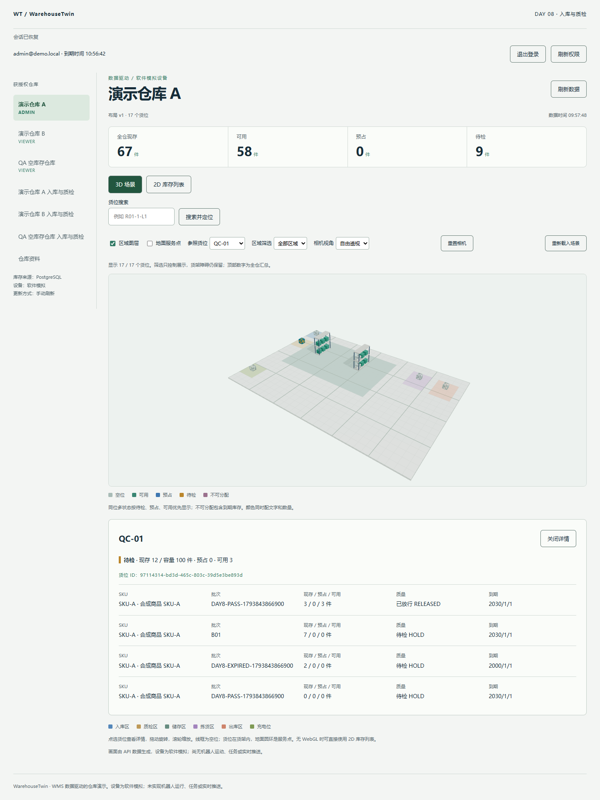

# Day 8 验收：入库、批次与质检

实际日期：2026-11-05，时区 Asia/Shanghai。代码基线 `6b8c5e7db7f1b5bba8a513e86274b6af8c7b203a`；本报告记录提交前的本地验收结果，不能把基线当作实现提交。验收时尚未推送，没有本次远程 Actions 成功结论；提交后的 CI 状态以对应提交的 Actions 为准。

## 最小交付

一单一个已有 SKU/批次，全量收货到当前布局 QC/HOLD；一次全量质检通过或拒绝。新建批次或复用日期完全相同的批次；过期可收进隔离库存，不能放行。admin/operator 可写、viewer 只读。创建、收货、质检均带幂等 key 和原因，操作者由会话确定。

可审查的三个边界：①模型/迁移/共享契约；②NestJS 事务 API 与真实 DB 测试；③React 表单、Query 同步、浏览器回调和报告。详细事务设计见 [ADR 0005](../docs/adr/0005-inbound-and-inspection.md)。

## 5 项可观察验收

| 条件 | 实际验证 | 结果 |
| --- | --- | --- |
| 收货不重复增加库存 | 相同 key 并发/重放、同 key 改参冲突；不同 key 与操作者竞争同单；浏览器在 DB 提交后丢弃响应，再次提交复用 key | 通过 |
| HOLD 与过期隔离 | 收货后现存/HOLD 增加而可用不变；过期可收、放行 409、拒绝保持 HOLD；无效数量、非法日期、批次日期冲突均拒绝 | 通过 |
| 质检按单据推进且守恒 | 同批次多单只释放本单数量，seed/其他 HOLD 不被释放；相反质检决定并发只提交一次，操作者/原因/时间及流水可追溯 | 通过 |
| 原子性、权限和容量 | 注入流水/审计失败，余额/单据/幂等结果回滚；viewer/跨仓/撤权重放拒绝；两单争剩余 QC 容量只成功一单 | 通过 |
| 刷新与显示一致 | API 重启后数据相同；两个 DB 重启后全量对账 0 差异；浏览器整页刷新后单据存在，3D 汇总/2D 详情匹配 API；只读与切仓列表隔离 | 通过 |

## 当日命令与结果

- `pnpm db:generate`：Prisma 6.19.3 生成成功。
- `pnpm check`：lint、strict typecheck、契约/API/Web build 成功。
- `pnpm test:unit`：6 文件，39 项通过：既有 35 + inbound/data 4。
- `pnpm test:integration`：3 suites，64 项通过：auth 18、inventory 26、inbound 20。新增测试包含失败注入，不只 mock ORM。
- 临时 PostgreSQL 集群分别建立 `warehouse_twin_test`、`warehouse_twin_inbound_test`，各自应用 5 条迁移和 seed；真实重启后两库全量复算 consistent=true、mismatches=0。
- Playwright CLI `day8-inbound.js`：passed=true，丢失响应重试同 key、一次入账、通过 3 件、拒绝 2 件、过期放行被拒、重载后数据保持、场景/2D 匹配。
- Playwright CLI `day8-access.js`：viewerReadOnly=true、crossWarehouseListIsolated=true、adminFormRestored=true。
- Playwright CLI `day8-session-expiry.js`：真实 QA 会话过期后刷新入库单，返回登录、旧订单与写表单均清除。

Windows x64，Node 22.14.0，pnpm 11.25.0，PostgreSQL 18.6，Chrome；浏览器 viewport 1440×1100。未测 FPS、吞吐或长期资源。3D chunk 938.10 kB、gzip 249.74 kB 的既有警告保留；Three.Clock 弃用警告保留。故障注入的网络失败/409、初始匿名 401 属于预期，未声称整个会话零控制台错误。

## 浏览器实际账面

普通 seed A 仓起点：现存 62、可用 55、预占 0、HOLD 7。真实 UI 创建两个不同批次：

1. 3 件收货：QC/HOLD 增 3；模拟丢失响应后重试，不二次入账。通过后同位 HOLD 减 3、RELEASED 加 3，全仓现存仍 65，可用 58。
2. 2 件过期批次收货：仍进入 HOLD；尝试 PASS 被拒，再 REJECT，不减少现存或解除隔离。

最终：**现存 67、可用 58、预占 0、HOLD 9**。QC-01 现存 12，其中原始 HOLD 7、新拒绝 HOLD 2、通过 RELEASED 3；零净额 HOLD 行保留。API、刷新后的单据、3D 汇总与 2D 批次详情均实际对照。

## 失败、修正与未覆盖

首轮 typecheck 发现 Batch.id 无默认值，创建新批次须显式 UUID，修正后通过。首轮入库 18 项通过，但共享 DB 的额外仓库污染旧授权测试总数，造成 3 项失败；改为同集群两个独立测试 DB，旧断言未放宽。分库第一次因库名含数字触发已有便携库命名限制，改名而不放宽限制。随后新增数据库约束与容量竞争两项，最终 64 项通过。

viewer 浏览器断言最初对 fieldset 本身调用 isDisabled 返回 false；快照确认实际 input/button 禁用，改查可交互控件并重验通过。这是验收方法修正，不把失败记录删除。

收尾将新模型的 onUpdate=NoAction 显式声明为迁移 SQL 的实际外键行为，避免 schema 与迁移默认值漂移。重新 generate 时仍在运行的 QA API 占用 Windows 引擎 DLL，首次重命名失败；关闭本次 QA 后正常生成，再完成 typecheck/lint。没有结束其他项目进程或修改依赖。

没有部分收货、分次质检、撤销、退货、SKU 管理、跨批分配、预占、机器人、Socket、队列或新框架。列表只返回最近 100 单并提示 hasMore，没有完整分页。日期以 UTC 零点解释。成功幂等记录当前不自动清理；未测长期存储量。

前端未确认创建 key 只保存在当前挂载页面；跨刷新不保证复用，未知结果应先读取单据确认；对已存在单据收货/质检，服务端阶段约束仍防重复。Abort/超时不等于取消已提交事务。没有把这一方案称为所有网络情形下的 exactly-once 投递。

开发库没有被 reset 或迁移；测试验证了新库按迁移安装、seed、运行与重启，未执行生产数据升级/部署。旧 PDF 版本与每周更新规则不改。

## 证据与复现

原始 JSON：`reports/unit.json`、`reports/integration-jest.json`、`reports/integration-environment.json`、`reports/integration-inventory.json`（忽略入 Git）；inventory 报告的 `databases` 分别记录两库。真实 UI 回调在 `scripts/browser-checks/day8-*.js`，详见[浏览器验收说明](../scripts/browser-checks/README.md)。

本地运行：先 `pnpm db:generate`、启动 DB、`pnpm db:migrate`，再启动应用。进入授权仓库的“入库与质检”，创建单据、收货、质检，再进入场景/列表检查。独立测试使用 `pnpm test:integration` 或交互运行 `pnpm qa:browser`，不用开发凭据。
