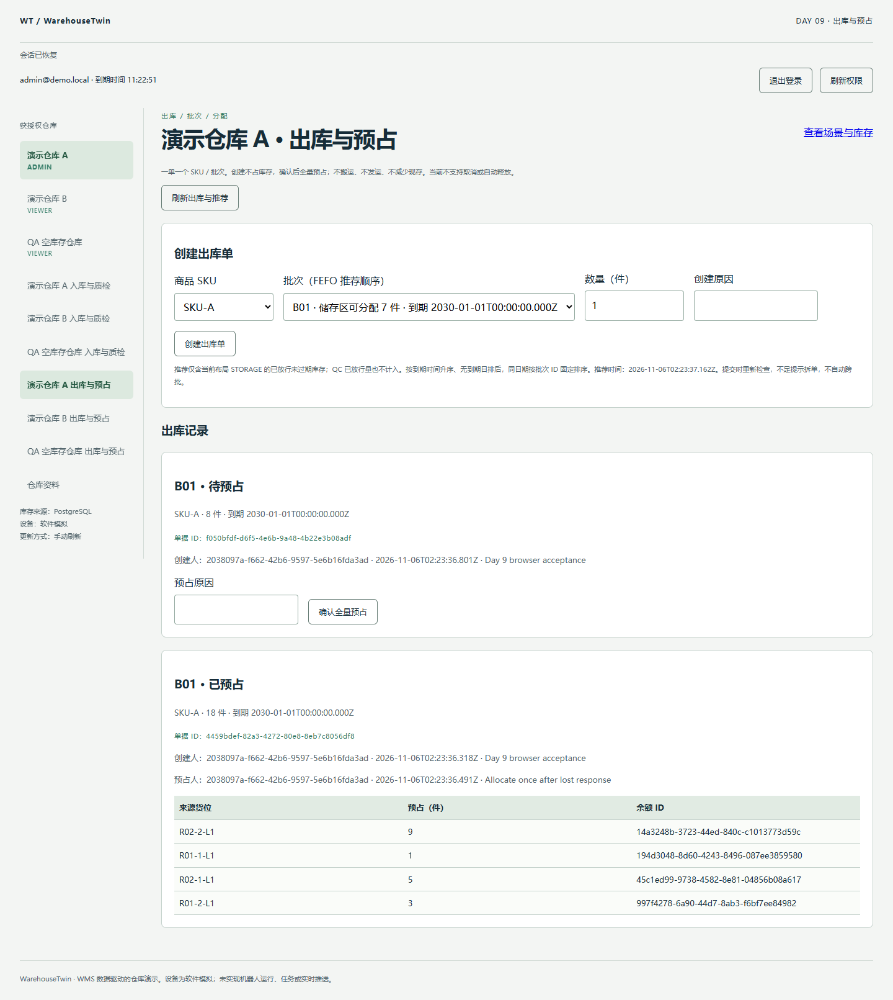
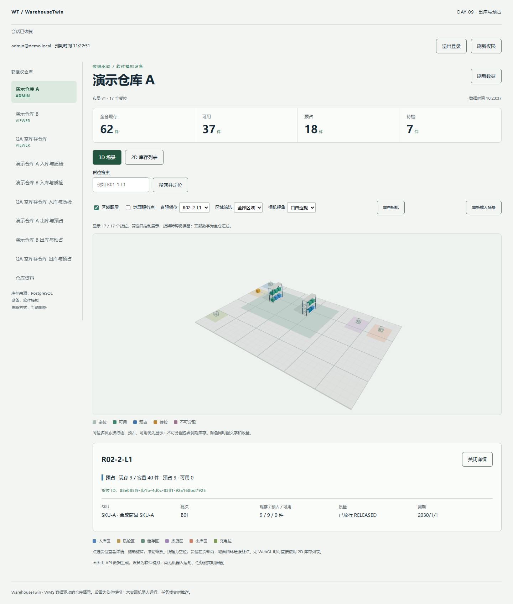

# Day 9 验收：出库、FEFO 与原子预占

实际日期：2026-11-06，Asia/Shanghai。基线 `35509cdb121467594dcffeb51e20a93bbeb0116f`。本报告记录 Day 9 提交前的本地实现和验收；尚未提交/推送，不把基线当作本次实现 SHA，没有本次远程 CI 成功结论。

## 最小交付

单 SKU/批次单据、CREATED→ALLOCATED、当前布局储存区的已放行未过期来源、同批多储位全量预占、FEFO 推荐、逐余额分配记录、key/hash 幂等、事务审计和预占对账。没有取消、自动释放、搬运或发运命令。

可审查的三个改动：①模型/迁移/契约；②事务 API/对账与真实 DB 反例；③页面/浏览器回调/报告。详见 [ADR 0006](../docs/adr/0006-outbound-allocation.md)。

## 5 项可观察验收

| 条件 | 当日实际验证 | 结果 |
| --- | --- | --- |
| 单批次预占不超分配 | 两单竞争同批次仅一单成功；余额 reserved≤onHand；多储位总量等于订单量 | 通过 |
| 推荐不是库存承诺 | FEFO 早到期优先、无日期排后、同日期稳定；HOLD/过期/QC 排除；推荐后发生竞争/批次到期，提交重新拒绝；不足不自动跨批 | 通过 |
| 命令重试与权限可靠 | 同 key 并发/重放一次过账，改参冲突；同单不同 key/操作者仍仅一次分配；viewer/跨仓/伪造字段/撤权重放拒绝 | 通过 |
| 所有预占写入原子 | 第二条 Allocation 及 AuditLog 注入失败，先前 reserved/分配/状态/幂等结果全部回滚；原 key 可重试 | 通过 |
| 持久化与显示可核对 | API 重启与 DB 重启后两种对账均无差异；浏览器丢失响应重试、整页重载、分配明细、3D/2D/API 一致 | 通过 |

## 本地检查

- `pnpm db:generate` 成功，Prisma 6.19.3。
- `pnpm check`：lint、strict typecheck、契约/API/Web build 全通过。
- `pnpm test:unit`：7 文件、43 项通过：坐标 7、数据 12、错误态 1、库存视图 9、相机 6、入库数据 4、出库数据 4。
- `pnpm test:integration`：4 suites、86 项通过：auth 18、inventory 26、inbound 20、outbound 22。Day 9 沿用同一个临时 PostgreSQL 集群，出库每个用例独立建仓/seed，写入位于既有 `warehouse_twin_inbound_test`，原回归库不受污染。
- `warehouse_twin_test`、`warehouse_twin_inbound_test` 真实重启后 physical mismatches=0、reservation mismatches=0，包含订单分配总量。测试故意删除 Allocation 或改变 reserved 时检测器能报告差异，不只是正常库返回空列表。
- Playwright CLI `day9-outbound.js`：passed=true，丢失响应原 key 重试、18 件/4 条分配、不足 8 件整单拒绝、重载与场景/列表对照通过。
- `day9-access.js`：viewerReadOnly=true、crossWarehouseListIsolated=true，返回 A 仓恢复原列表。
- QA 会话过期后刷新出库，返回登录表单；最终浏览器快照确认“会话已到期或失效”，出库记录、创建表单及场景均已清除。

Windows x64，Node 22.14.0，pnpm 11.25.0，PostgreSQL 18.6，Chrome，viewport 1440×1100。前端主 JS 421.56 kB / gzip 128.87 kB；3D chunk 938.10 kB / gzip 249.74 kB，既有 >500 kB 警告和 Three.Clock 弃用警告保留。没有 FPS、吞吐、长期资源或跨浏览器性能成绩。

## 浏览器账面与实际记录

普通 seed A 仓起点：现存 62、可用 55、预占 0、HOLD 7。SKU-A/B01 储存区可分配 25。创建 18 件单据时不改变库存；确认预占后产生以下 4 条记录：

| 来源货位 | 分配件数 |
| --- | --- |
| R02-2-L1 | 9 |
| R01-1-L1 | 1 |
| R02-1-L1 | 5 |
| R01-2-L1 | 3 |

这是普通 seed 在本次 QA 的实际明细，服务端按稳定 ID 选择来源，UI 明细按余额 ID 排序；不宣称此排序是最优拣货路线。后端提交成功后浏览器主动丢弃响应，原表单再次请求使用同一 key，数量仍只增加 18。随后同批申请 8 件，但剩余只有 7，409 且无部分预占残留；单据保留 CREATED。

最终：**现存 62、可用 37、预占 18、HOLD 7**。全部余额 onHand 与预占前逐行相同，没有位置转移或移动流水。整页刷新后 18 件单据及 4 条分配仍存在，选中储位的 3D/2D 详情文字一致，预占蓝色和汇总可见。

## 状态权威、事务与同步

PostgreSQL 是单据、分配、余额、审计和幂等结果的权威。写命令事务内复查访问权，再锁仓库/单据/批次/货位/余额，条件 UPDATE 预占并写分配、审计和成功响应，全部提交或回滚。推荐与提交使用相同来源规则，但推荐仅为读取快照，不能凭前端可用总量提交；客户端传 available/actor 等字段会被拒绝。

Query 缓存出库/推荐和库存快照，成功后按 user/space/warehouse 精确失效；Zustand 不复制库存，R3F 只展示。原物理流水对账保留，新函数检查 reserved 与分配、订单量与分配。`pnpm reconcile` CLI 仍只做 onHand 对账；新对账由集成入口实际调用，不把旧命令冒充完整业务对账。

## 修正、限制与未执行项

首轮完整数据库 86 项通过；收尾 lint 发现 actor 变量未使用，补创建者身份断言后重新执行 check 和完整数据库回归。没有修改旧断言、关闭约束或填造结果。

预占来源限定 STORAGE；QC 已放行也不计这里的可分配量。当前没有盘点冻结，不宣称已经排除尚不存在的冻结状态；后续接入时需统一扩展来源校验。无跨批自动拆单、取消、自动释放、运输、发运、机器人、Socket 或队列。没有生产升级/部署；只在隔离新库按全部 6 条迁移安装测试，不 reset 开发库。

幂等请求 key 只在当前页面保存；跨刷新创建 key 不自动恢复，未知创建结果先刷新核对。不同 key 新建单据是另一条创建命令，没有外部订单号防重；同一既有单据重复预占仍受服务端阶段保护。成功记录无自动清理，预占后批次过期不会自动释放，留待后续明确流程；列表只提供最近 100 单。

故障注入会产生预期网络失败、409 和初始匿名 401；不声称整个浏览器会话零控制台错误。历史 PDF 与每周生成规则保持原样。

## 证据与复现

本地原始 JSON 在 `reports/unit.json`、`reports/integration-jest.json`、`reports/integration-environment.json`、`reports/integration-inventory.json`，忽略入 Git。重启报告的 `databases` 各有 mismatches/reservationMismatches，顶层 consistent 同时检查二者。

重现：`pnpm db:generate`、`pnpm check`、`pnpm test:unit`、`pnpm test:integration`；浏览器使用新的 `pnpm qa:browser`，按[验收说明](../scripts/browser-checks/README.md)依次运行 Day 9 回调。不要先执行 reserve 夹具或使用已被占量的旧 QA 库冒充普通 seed。
