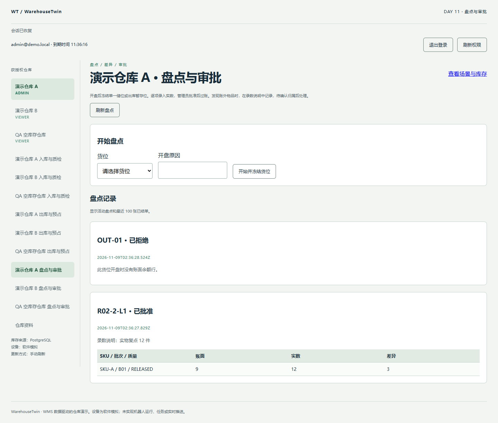

# Day 11 验收报告

日期为 2026-11-09（Asia/Shanghai），基线为 `168e34f`。本地运行环境为 Windows x64、Node 22.14.0、PostgreSQL 18.6。

## 交付与审查顺序

1. **模型与账本。** 两条追加迁移分别扩展流水类型并落盘点表、单货位活动唯一约束和冻结触发器。现有账本对账直接复算盘盈、盘亏。
2. **冻结与审批事务。** 新增仓库内盘点 API。出库与运输接入冻结检查。提交实数后由管理员审批，批准前重查布局、余额集合、版本、预占和容量。
3. **页面与验证。** 增加盘点与审批入口。复用 React Query、仓库权限和请求重试逻辑。真实数据库并发测试、浏览器脚本和截图随报告保存。

## 观察结果

| 验收条件 | 实际结果 |
| --- | --- |
| 开盘、录数、拒绝 | 账面 9 件录入 12 件后，余额及流水保持原值。拒绝释放冻结，库存不变。viewer 不能开盘，操作员不能审批，跨仓单据无法读取或处理。 |
| 盘盈、盘亏、零差及回滚 | 账面 9 件分别批准为 12、6、9。前两笔各一条 3 件的单向流水，零差无调整流水。并发同 key 批准只过账一次。注入调整流水写入失败后，余额、单据状态及审计回滚，原 key 重试成功。 |
| 盘点与出库竞争 | 盘点和需要全部 25 件的分配同时提交，只有一个成功。浏览器另外验证了冻结先提交时 25 件分配返回 409。预占成立后开盘同样返回 409。 |
| 空暂存位与运输 | 空暂存位已有 READY 或 IN_TRANSIT 任务时拒绝开盘。先冻结则拒绝创建以该位为目标的运输任务，数据库也拒绝向冻结空位新增余额行。 |
| 快照与容量保护 | 模拟特权维护改动余额版本或新增零余额行，审批返回 409 并保持冻结。储位录入 41 件超过 40 件容量时，审批也返回 409。 |

## 自动化与浏览器

- `pnpm db:generate`、`pnpm check` 通过。前端 7 个文件共 44 项通过。
- `pnpm test:integration` 通过 102 项。Jest 95 项包含新增 9 项盘点 API 测试，Node 内置测试 7 项包含新增 1 项盘点与运输互斥测试。
- 两个隔离 PostgreSQL 库均应用 10 条迁移。真实重启后，实物流水差异和扩展预占差异分别为 0 和 0。
- Chrome 使用隔离 QA 环境。冻结 `R02-2-L1` 后，SKU-A/B01 的储存区可分配量从 25 降到 16。提交实数 12 后，全仓现存仍为 62。批准后该位为 12 件，全仓现存为 65、可用为 58、预占为 0、HOLD 为 7，推荐恢复为 28。空暂存位拒绝结单后可再次选择。整页刷新仍可看到两张终态单据。



## 复现与范围

```powershell
pnpm db:generate
pnpm check
pnpm test:unit
pnpm test:integration
```

浏览器复现见[验收脚本说明](../scripts/browser-checks/README.md)。原始机器报告为 `reports/unit.json`、`reports/integration-jest.json`、`reports/integration-transport.tap` 和 `reports/integration-inventory.json`。状态、锁和差额规则见 [ADR 0008](../docs/adr/0008-inventory-count.md)。

盘点限于储位和暂存位的已登记余额。账外品通过录数说明记录，管理员可批准自己发起的盘点。测试使用新建隔离数据库，开发库升级、远程 CI 和跨浏览器验证待后续执行。
