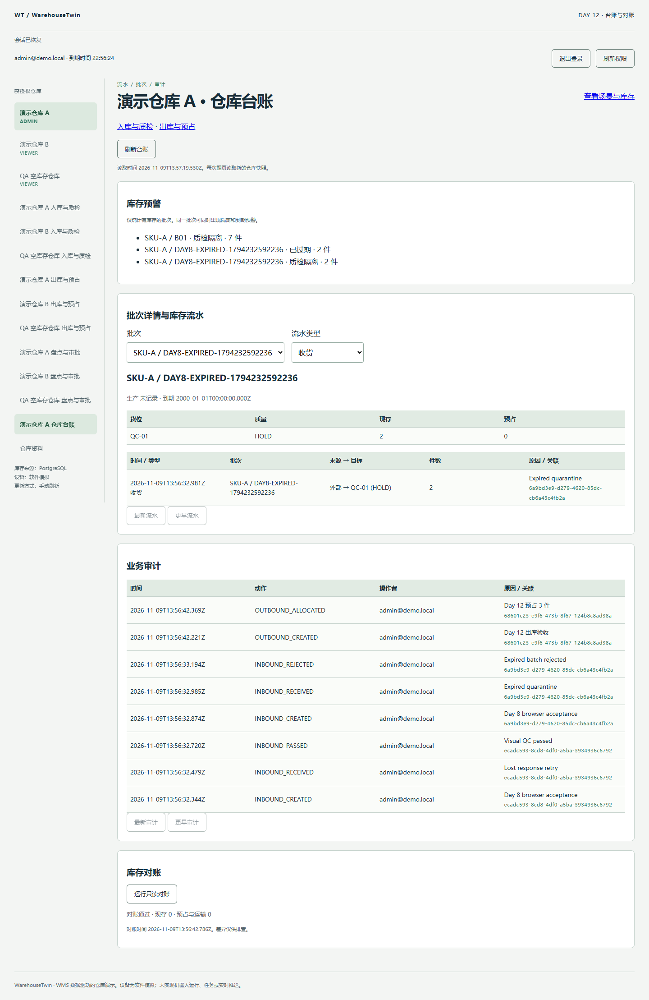

# Day 12 仓库台账与对账验收

日期为 2026-11-09（Asia/Shanghai），基线为 `1e6312c`。

## 改动与审查顺序

1. **台账读取。** 增加仓库范围内的流水、批次余额、业务审计和预警接口及契约。流水按类型与批次筛选，流水和审计各自按时间与 ID 翻页。
2. **对账。** 将现存和预占两组检查放入同一个一致性快照。CLI 覆盖全部仓库，HTTP 限当前获授权仓库。对账检查订单分配、在途货物、暂存容量，以及实体和虚拟库位的余额。
3. **页面和验收。** 仓库台账链接至已有入库质检和出库预占页面，展示批次、流水、审计、库存预警和按需对账。

## 实测结果

| 验收条件 | 观察结果 |
| --- | --- |
| 业务流程 | 在 Chrome 通过现有页面收货 5 件，其中 3 件放行、2 件过期隔离，再从储位预占 3 件。全仓现存 67、预占 3、可用 55、HOLD 9。预占出现在审计，仓库现存未减少。 |
| 筛选与分页 | 浏览器按收货筛出 2 条流水，再按过期批次筛出 1 条。数据库同时间夹具中，流水两页为 25+11 条，审计两页为 25+5 条，ID 均无重复或遗漏。 |
| 批次与预警 | 浏览器查到过期批次在 QC-01 的 2 件 HOLD。数据库夹具核对 32 件近效期现存、7 件隔离与另一批次 30 件过期现存。 |
| 仓库授权 | 匿名返回 401，viewer 返回 403，跨仓请求返回 404。外仓流水游标、错筛选游标和重复参数均被拒绝。 |
| 对账差异 | 注入现存与预占差异后，当前仓库分别返回 1 条差异，另一仓库仍通过。人为清空在途余额能报告缺少 1 件在途货物。CLI 有差异退出码为 1，恢复后为 0。两库重启后全部检查零差异。 |

`pnpm check`、44 项前端测试、107 项数据库集成测试通过。数据库测试包括 Jest 99 项与 Node 内置测试 8 项。实测环境为 Windows x64、Node 22.14.0、PostgreSQL 18.6 与 Chrome。首次运行发现增加范围 CTE 后，PostgreSQL 要求显式列出订单聚合中的状态及数量。修正后完整回归通过。



## 状态与边界

台账和对账均读取 PostgreSQL，保持现有业务命令的事务边界。HTTP 在同一个 Repeatable Read 事务内检查仓库权限并读取数据。翻页会读取新快照，游标按 `createdAt DESC, id DESC` 记录边界，必须来自当前仓库及筛选范围。新入账的记录可通过“最新流水”读取。

流水记录实物来源和去向，业务审计记录操作人、原因和关联单据。出库预占改变可用量而不产生物理流水，其操作留在审计。库存预警以同一请求时点计算已过期、未来 7×24 小时内到期和质检隔离。有现存的批次可能同时触发日期及隔离预警，两类件数分别解读。

这次沿用样例仓库规模。流水和审计分页，批次选择与预警随当前仓库一次读取。保留既有权限模型，台账诊断开放给管理员和操作员。未执行生产迁移、跨浏览器或负载验收。

## 复现

```powershell
pnpm check
pnpm test:unit
pnpm test:integration
```

浏览器复现见 [验收脚本说明](../scripts/browser-checks/README.md)。机器报告位于 `reports/unit.json`、`reports/integration-jest.json`、`reports/integration-transport.tap` 与 `reports/integration-inventory.json`。
