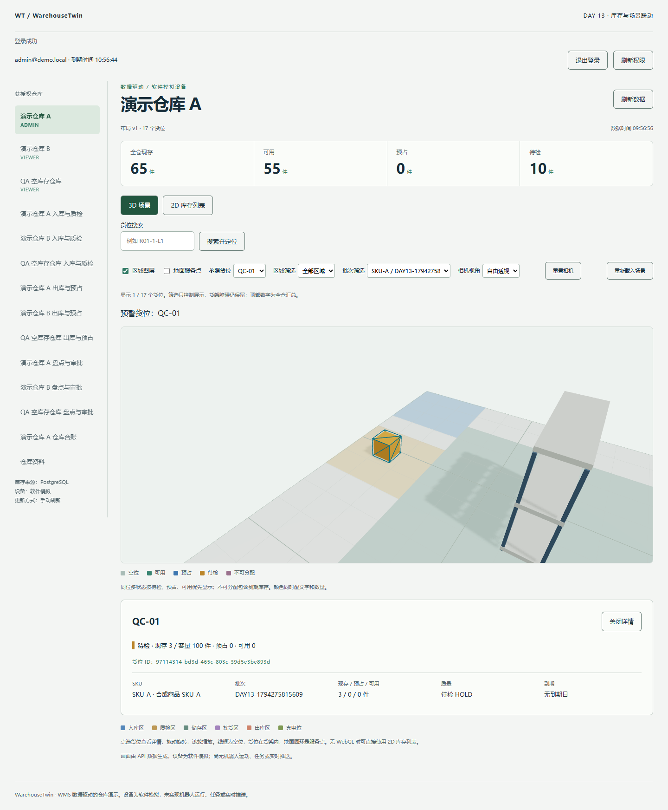
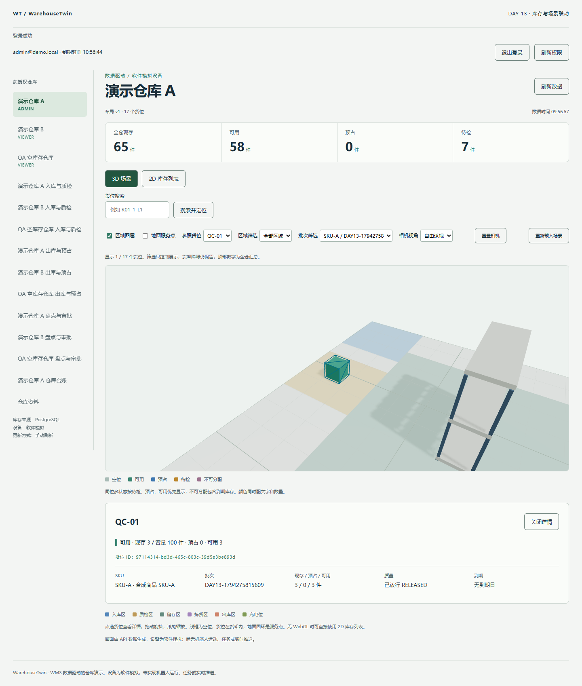

# Day 13 库存与 3D 联动验收

日期为 2026-11-10（Asia/Shanghai），基线为 `07547c4`。

## 两个可审查改动

1. **按范围刷新。** 写入成功后失效当前用户、空间与仓库的业务列表、库存快照、台账和对账缓存。活跃页面重新读取，对账仍按需执行。盘点额外失效出库推荐。继续使用已有撤销信号、作用域检查和版本配对。
2. **场景筛选与定位。** 批次和区域筛选以同一 API 快照派生列表、颜色及详情。台账预警通过链接传入批次和预警类型，场景以当前快照重新定位实体货位。

## 实测结果

| 验收条件 | 观察结果 |
| --- | --- |
| 收货与质检同步到场景 | 通过页面收货 3 件，预警定位到 QC-01，选中批次为琥珀色待检，详情为现存／预占／可用 3／0／0。质检放行后同一批次变为绿色，详情为 3／0／3。全仓现存均为 65，待检从 10 降为 7，可用从 55 升到 58。 |
| 组合筛选 | 选中该批次后，储存区显示无匹配，切回质检区只有 QC-01。详情只列选中批次，顶部仍是全仓汇总。 |
| 预警定位 | 从台账待检预警进入场景，自动选中该批次与 QC-01。相机最终位置目标和实际布局坐标一致。单元测试确认零余额及虚拟在途不会被当成可定位实体。 |
| 切仓与错误恢复 | 浏览器拦截 A 仓刷新并确认同步提示。切换到 B 仓后，A 的未完成库存请求被 Chromium 中止。B 保持自己的 62 件现存及默认筛选。注入 503 后场景和旧汇总隐藏，解除拦截后点击重试恢复。 |

`pnpm check`、47 项前端测试及 107 项 PostgreSQL 集成测试通过。新增前端断言覆盖混合货位批次计算、预警目标与缓存作用域。两个隔离数据库实际重启后，现存和扩展预占检查均为零差异。浏览器验收在 Windows 的 Chrome 中执行，视口为 1440 × 1100。收尾发现关闭详情可能改变相机目标，修正后重跑 Day 13，并通过原有两处货位点击、货架遮挡和俯视空位点击测试。





## 边界

仓库快照仍是权威，筛选结果不会写入 Zustand 或后端。区域层和货位显示可筛选，货架几何保持完整。选择批次后，货位数量仅汇总该批次，顶部汇总仍覆盖全仓。在途余额计入全仓，但没有可供相机定位的实体坐标。若预警期间库存变化，页面说明当前没有可定位实体。

本次采用操作后刷新和手动刷新。实时推送、生产负载和跨浏览器矩阵属于后续验收。

## 复现

```powershell
pnpm check
pnpm test:unit
pnpm test:integration
```

浏览器复现见 [验收脚本说明](../scripts/browser-checks/README.md)。
