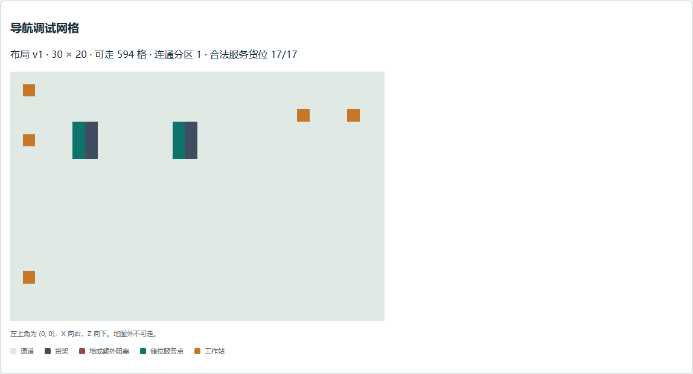

# Day 15 导航网格验收

日期为 2026-11-11（Asia/Shanghai），源码基线为 `df836c8280af1f06d4bcb68d914a4486baf3a5e7`。实现方案、状态权威与边界见 [开发日志](../docs/devlog/day-15.md)。

## 浏览器实测

在 Windows Chrome 和独立 QA PostgreSQL 的普通 seed A 仓验证，API 为 13004、前端为 15174、数据库为 15434。

| 观察项 | 实测结果 |
| --- | --- |
| 完整布局 | 30 × 20，6 个架体阻塞格，594 个可走格，1 个连通分区。 |
| 合法服务点 | 17/17 个货位，11 个独立地面服务点。逐点核对 Canvas 像素与 API 的储位/工作站类型。 |
| 展示筛选 | 切换 2D、筛选 QC 后，整幅导航图像素完全一致。 |
| 不连通提示 | 浏览器拦截布局响应，添加 z=10 的 30 格阻塞行，变为 564 个可走格、2 个分区，出现不连通提示。 |
| 恢复与开关 | 移除拦截后刷新恢复 594 格、1 个分区，关闭调试后面板消失。 |

断图用例使用响应拦截，数据库布局保持普通 seed。截图经人工查看，中文、图例和货架/服务点均可辨识。



## 自动检查

```powershell
pnpm check
pnpm test:unit
pnpm test:integration
```

最终 `pnpm check` 通过 lint、类型检查和生产构建。前端 9 个测试文件、51 项测试通过，其中 4 项为新增导航网格测试。首次加强储位层数校验后，双层共用服务点测试因单层夹具失败，修正夹具并重跑上述检查及前端测试后通过。

真实 PostgreSQL 集成回归通过 99 项 Jest/Supertest 测试和 8 项 Node 内置运输测试，共 107 项。两个隔离数据库均真实重启，现存与扩展预占对账为零差异，`databaseRestarted` 和 `consistent` 均为 true，差异列表为空。集成命令退出码为 0。

浏览器复验流程与脚本见 [浏览器验收说明](../scripts/browser-checks/README.md#day-15-导航网格)。

本轮浏览器控制台的错误为登录前预期的 `/auth/me` 401。另有现有 THREE.Clock 弃用警告与测试读取 Canvas 像素的 readback 提示。生产构建继续提示场景 chunk 超过 500 kB。

本地原始测试输出位于忽略入 Git 的 `reports/unit.json`、`reports/integration-jest.json`、`reports/integration-environment.json`、`reports/integration-inventory.json` 和 `reports/integration-transport.tap`。本报告保留本轮测得的摘要。

## 限制

导航网格为静态四邻接拓扑。上限单边 512、总格数 65,536，属于同步调试计算的实现预算。大地图性能、动态障碍和机器人执行尚待其对应计划验证。纯网格模块目前由前端消费，后续复用时可依据实际调用位置调整。
